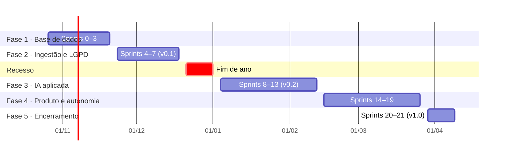

# Roadmap — 24 semanas (26/10/2026 a 09/04/2027)

São 22 sprints de 1 semana e 2 semanas de recesso. A dificuldade sobe aos poucos e a assistência cai:
nas primeiras sprints quase tudo vem pronto; nas últimas, ela escreve as próprias issues.
A fonte de verdade das datas é o [`roadmap.yml`](roadmap.yml).

| Sprint | Semana | Fase · assistência | Objetivo | Marco / observação |
|---|---|---|---|---|
| 0 | 26–30/10 | 1 · alta | Ambiente rodando, banco criado e carregado com a base real, primeiro PR | onboarding |
| 1 | 03–06/11 | 1 · alta | Consultas, diagnóstico de qualidade e primeiro tratamento de texto | Finados (02/11) |
| 2 | 09–13/11 | 1 · alta | Perguntas de negócio com SQL e primeira análise no app | |
| 3 | 16–19/11 | 1 · alta | Regras de qualidade como testes e limpeza na carga | Consciência Negra (20/11) |
| 4 | 23–27/11 | 2 · média | Cliente do PNCP que respeita o limite (429, backoff, Retry-After) | |
| 5 | 30/11–04/12 | 2 · média | Validar resultados da API e registrar execuções | possível semana de provas |
| 6 | 07–11/12 | 2 · média | LGPD no pipeline: nada pessoal identificável no banco | possível semana de provas |
| 7 | 14–18/12 | 2 · média | Ingestão incremental agendada e primeira publicação | **v0.1 publicada** |
| — | 21/12–01/01 | — | Recesso | a confirmar |
| 8 | 04–08/01 | 3 · média | Embeddings das contratações e custo em espaço | |
| 9 | 11–15/01 | 3 · média | Busca por significado no app | |
| 10 | 18–22/01 | 3 · média | Qualidade da busca (precision@5) e busca híbrida | |
| 11 | 25–29/01 | 3 · baixa | Resumos com LLM local, prompt versionado e fallback | |
| 12 | 01–05/02 | 3 · baixa | Avaliação de resumos com golden set | |
| 13 | 08–12/02 | 3 · baixa | Resumos em lote no Actions e no app | **v0.2** · Carnaval |
| 14 | 15–19/02 | 4 · baixa | Caber nos 500 MB: medir, reter e agregar | |
| 15 | 22–26/02 | 4 · baixa | Painel analítico de mercado | |
| 16 | 01–05/03 | 4 · autonomia | Ampliar UFs e modalidades, com ADR dela | |
| 17 | 08–12/03 | 4 · autonomia | Observabilidade: alertas e relatório semanal | |
| 18 | 15–19/03 | 4 · autonomia | Performance de consultas e testes de integração | |
| 19 | 22–25/03 | 4 · autonomia | Feature escolhida e planejada por ela | Sexta-feira Santa (26/03) |
| 20 | 29/03–02/04 | 5 | Hardening, documentação e relatório técnico | **v1.0** |
| 21 | 05–09/04 | 5 | Demo final, avaliação final e retrospectiva | encerramento |

## Como a assistência diminui

| Fase | O tech lead entrega | A estagiária faz |
|---|---|---|
| 1 | código pronto, TODOs pequenos, testes escritos, dicas detalhadas | completa funções e SQL guiados por testes |
| 2 | esqueleto do módulo e testes principais | funções inteiras e alguns testes |
| 3 | arquitetura e contratos (interfaces) | implementação, testes e avaliação |
| 4 | o problema e os critérios de aceite | proposta de solução (ADR), issues e implementação |
| 5 | acompanhamento | conduz a entrega, a demo e o relatório |

Os `TODO(estagiaria)` de cada sprint entram no código quando a sprint é planejada, e não antes.
Assim o código nunca tem tarefas "fantasmas".
