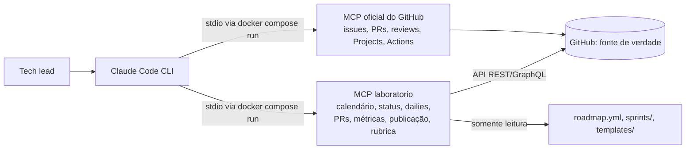

# Gestão do laboratório (Docker local + MCP + Claude Code)

O "cérebro" do laboratório é o **Claude Code** rodando dentro deste repositório. Ele conversa com o
GitHub por dois servidores MCP que rodam no Docker local do tech lead:



Nada de banco ou ferramenta de gestão paralela: **todo estado fica no GitHub**. Os servidores sobem sob
demanda (um container por sessão) e somem quando o Claude Code fecha.

## Configurar (uma vez)

1. Crie um token *fine-grained* com as permissões listadas em `gestao/.env.example`.
2. Rode `cp gestao/.env.example gestao/.env` e cole o token. O `.env` está no `.gitignore`.
3. Rode `docker compose -f gestao/docker-compose.yml build`.
4. Abra o Claude Code na raiz do repositório `laboratorio` e aprove os servidores do `.mcp.json`
   quando ele perguntar. Confira com `/mcp`.

## Usar

| Comando no Claude Code | Para quê |
|---|---|
| `/daily` | ler as dailies, ver faltas e bloqueios, rascunhar respostas |
| `/status-sprint` | panorama e riscos da sprint |
| `/revisar-pr radar-licitacoes 12` | revisão técnica + processo, com comentários em rascunho |
| `/review-sprint` · `/retro` · `/avaliar 0` | rituais de sexta-feira |
| `/planejar-sprint 2` | escrever e publicar a próxima sprint |

Toda ação que altera o GitHub (comentar, revisar, publicar) aparece primeiro como prévia e só acontece
depois do seu OK. Isso está nas instruções do servidor e no `CLAUDE.md`.

## Ferramentas do MCP `laboratorio`

| Ferramenta | Tipo | Descrição |
|---|---|---|
| `sprint_atual` | leitura | sprint de hoje segundo o `roadmap.yml` |
| `status_sprint(numero?)` | leitura | issues da milestone, prazos, atrasos e status no quadro |
| `dailies(dias)` | leitura | comentários da daily, dias úteis sem daily e bloqueios |
| `prs_em_revisao()` | leitura | PRs abertos: título, `Closes #`, seções de IA e explicação, CI e revisões |
| `metricas_sprint(numero)` | leitura | no prazo, lead time, PRs mergeados, rodadas de ajuste |
| `publicar_sprint(numero, executar)` | escrita | cria labels, milestone e issues da pasta `sprints/` (idempotente) |
| `garantir_daily(executar)` | escrita | cria e fixa a issue da daily |
| `rubrica()` / `montar_avaliacao(...)` | apoio | critérios e markdown da avaliação |

## Desenvolvimento do MCP

```bash
cd gestao/mcp-laboratorio
uv run pytest            # 13 testes, inclusive o protocolo MCP em memória
uv run ruff check .
```
